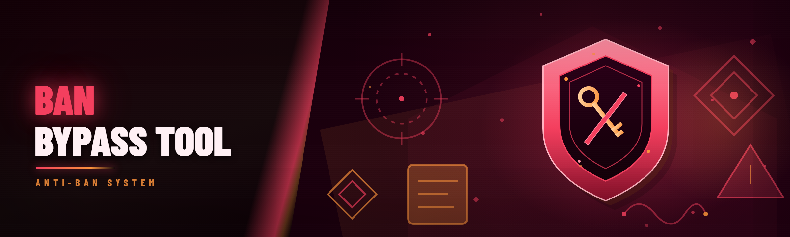

  
  
  

  

  
  

---

HWID spoofer and ban bypass tool: resets hardware identifiers, clears tracing, spoofs disk/GPU/MAC serials to unban accounts after HWID bans.

## Overview

HWID spoofer and ban bypass tool: resets hardware identifiers, clears tracing, spoofs disk/GPU/MAC serials to unban accounts after HWID bans.

  

## License

[MIT License](LICENSE)

  

